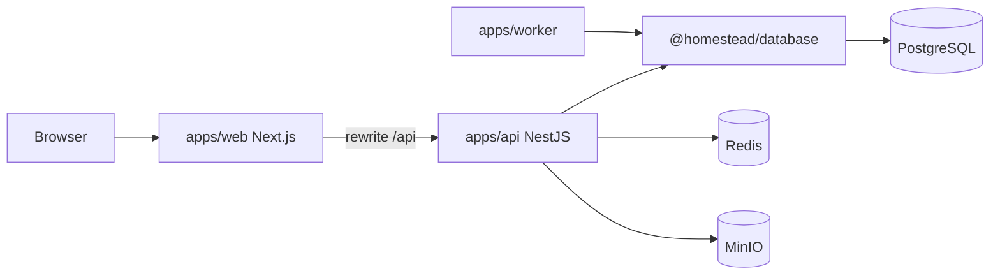

# Homestead Keep — Home Maintenance Manager

## Overview

Homestead Keep helps households track assets, warranties, recurring maintenance, service history, documents, and reminders.

This repository is a **Yarn Workspaces + Turborepo monorepo** with a NestJS API, Next.js web app, reminder worker, and shared Prisma database package.

## Architecture

```text
Browser → apps/web (Next.js :3005)
            ↓ same-origin /api rewrite proxy
         apps/api (NestJS :4005)
            ↓
         @homestead/database (Prisma)
            ↓
         PostgreSQL

apps/worker → @homestead/database → PostgreSQL
```



## Repository layout

```text
apps/web          Next.js + React UI (no Route Handler backend)
apps/api          NestJS REST API
apps/worker       Reminder background process (non-HTTP)
packages/database Prisma schema, migrations, seed, client (@homestead/database)
infrastructure/   Docker Compose (Postgres, Redis, MinIO)
docs/             Engineering documentation
```

ONE Git repository. Package manager: **Yarn** (`yarn.lock`). Task runner: **Turborepo**.

## Local development

### Prerequisites

- Node.js 20+
- Yarn 1.22.x
- Docker

### Start infrastructure

```bash
yarn infra:up
# or: docker compose -f infrastructure/docker-compose.yml up -d
```

Ports: Postgres **5434**, Redis **6380**, MinIO **9010/9011**.

### Install & database

```bash
cp .env.example .env
yarn install
yarn db:generate
yarn db:migrate:deploy
yarn db:seed
```

### Run applications

```bash
# three terminals, or use turbo:
yarn web:dev      # http://localhost:3005
yarn api:dev      # http://localhost:4005
yarn worker:dev
```

Or: `yarn dev` (turbo parallel for web + api + worker).

Demo login: `alex@example.com` / `Password123!`

### Auth / cookies

The browser talks only to **:3005**. Next.js rewrites `/api/*` to Nest at `API_URL` (default `http://127.0.0.1:4005`). Auth cookies (`hmm_access`, `hmm_refresh`) are httpOnly and flow through the proxy (same-origin to the browser).

## Scripts

| Script | Purpose |
| --- | --- |
| `yarn build` | Build all packages/apps |
| `yarn typecheck` | Typecheck via turbo |
| `yarn lint` | Lint via turbo |
| `yarn test` | API unit tests (Jest) |
| `yarn test:e2e` | Playwright critical path |
| `yarn db:*` | Prisma generate/migrate/seed |
| `yarn infra:up` / `infra:down` | Docker services |

## Testing

```bash
yarn workspace @homestead/api test
yarn test:e2e
```

## Deployment

- **apps/web** → Vercel (or similar) — UI only; set `API_URL` for server-side rewrites if used
- **apps/api** → Node host (Railway/Fly/VM) on port 4005
- **apps/worker** → always-on Node process
- **Postgres / Redis / MinIO** → Docker or free/self-hosted infra

Do not force API + worker onto Vercel. See `docs/deployment.md`.

## Documentation

See `docs/` for product requirements, architecture, database design, API design, security, testing, and deployment.

## License

MIT
