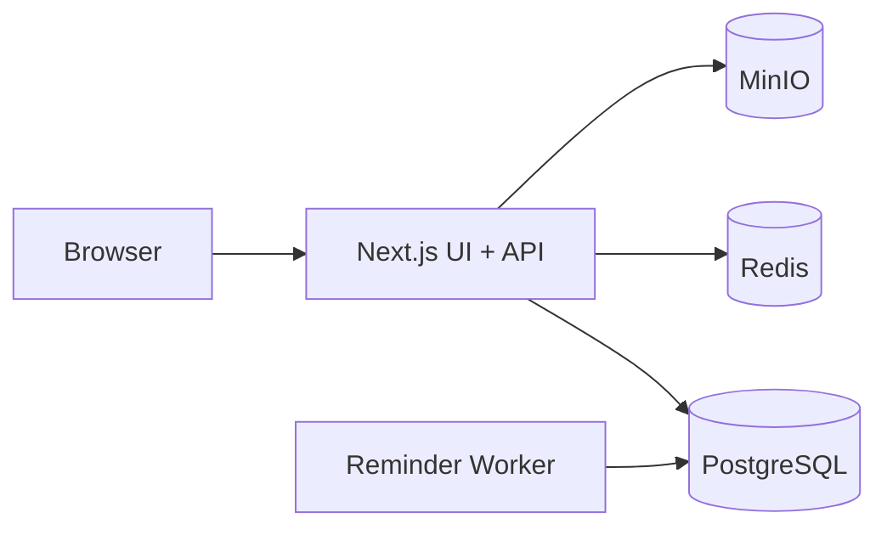

# Homestead Keep — Home Maintenance Manager

## Overview

Homestead Keep is a production-style home maintenance manager for tracking household assets, recurring maintenance, warranties, service history, document attachments, reminders, and audit history.

## Problem Statement

Households lose track of appliance service intervals, warranty windows, and repair evidence across paper manuals and ad-hoc calendar reminders. This system provides a shared household system of record.

## Goals

- Professional full-stack portfolio demonstration (auth, RBAC, Postgres, jobs, object storage, tests)
- End-to-end maintenance workflow that works locally with free/open-source tooling only
- Clean relational modeling and server-enforced authorization

## Key Features

- User authentication (bcrypt + JWT access + rotating refresh cookies)
- Household/property management with OWNER / MANAGER / MEMBER roles
- Asset registry with search, filter, pagination, soft delete
- Recurring maintenance schedules and transactional completion
- Service history and warranty tracking
- Document uploads via MinIO
- Reminder worker with idempotent dispatch → in-app notifications
- Dashboard aggregates and audit log

## User Roles

| Role | Capabilities |
| --- | --- |
| OWNER | Full household control including delete and member management |
| MANAGER | Manage assets, schedules, warranties, documents; manage MEMBER users |
| MEMBER | View data; complete schedules; create service records; upload documents |

## Technology Stack

- Next.js 16 (App Router) + React 19 + TypeScript + Tailwind CSS 4
- PostgreSQL 16 + Prisma 6
- Redis 7 (rate limiting + short dashboard cache)
- MinIO (S3-compatible documents)
- Vitest + Playwright
- Docker Compose for local infrastructure

## Architecture



See `docs/architecture.md` for request, auth, and worker flows.

## Architecture Diagram

Detailed diagrams live in:

- `docs/architecture.md`
- `docs/database-design.md`

## Application Flow

1. Register / login → httpOnly cookies
2. Create household (becomes OWNER)
3. Add assets
4. Create schedules and warranties
5. Complete maintenance → service record + next due date
6. Worker emits notifications for due/expiring items
7. Upload manuals/receipts to MinIO

## Database Architecture

PostgreSQL is the source of truth. Prisma migrations under `prisma/migrations`.

## ER Diagram

See `docs/database-design.md`.

## Database Tables

`users`, `refresh_tokens`, `households`, `household_members`, `assets`, `maintenance_schedules`, `service_records`, `warranties`, `documents`, `notifications`, `reminder_dispatches`, `audit_logs`

## API Documentation

See `docs/api-design.md`. All JSON APIs use:

```json
{ "success": true, "data": {} }
```

or

```json
{ "success": false, "error": { "code": "...", "message": "...", "details": null } }
```

## Authentication

- Access JWT (15m) in `hmm_access` httpOnly cookie
- Refresh token (30d) in `hmm_refresh` httpOnly cookie; stored hashed in DB; rotated on refresh
- Logout revokes refresh token

## Authorization

Server-side household membership checks via `requireHouseholdMember` and role ranking. Frontend never trusted for permissions.

## Security

See `docs/security.md`. Rate limits on auth and uploads. Secure headers via middleware. No secrets committed.

## Caching

Dashboard summary cached in Redis for 30s per user/household; invalidated on mutations. If Redis is down, queries hit PostgreSQL directly.

## Queue / Background Jobs

`npm run worker` polls every 60s, dispatches idempotent reminders into `notifications`.

## Error Handling

Central `AppError` + `handleRouteError` maps validation/auth/authz/not-found/conflict/rate-limit/internal errors.

## Logging

Structured `pino` logs with redaction of passwords/tokens.

## Testing

- Unit: recurrence, RBAC, password/JWT
- Integration: schedule completion against Postgres test DB
- E2E: Playwright critical path

## Performance Considerations

Partial/composite indexes documented in `docs/database-design.md`. List endpoints paginated.

## Local Development

```bash
cp .env.example .env
docker compose up -d
npm install
npx prisma migrate dev --name init
npm run db:seed
npm run dev
# separate terminal
npm run worker
```

App: http://localhost:3005  
Demo users after seed: `alex@example.com` / `Password123!`

PostgreSQL is exposed on host port **5434**, Redis on **6380**, and MinIO on **9010/9011** to avoid colliding with other local services.

## Docker Setup

```bash
docker compose up -d
docker compose ps
```

Services: Postgres, Redis, MinIO (+ bucket init).

## Environment Variables

Documented in `.env.example`.

## Deployment

See `docs/deployment.md`.

- Next.js app can deploy to Vercel
- Worker, Postgres, Redis, MinIO must run elsewhere (Docker host / free always-on VM)
- Never require paid SaaS for core functionality

## Project Structure

```text
src/app            Pages + API routes
src/components     UI primitives + shell
src/services       Domain services
src/lib            Auth, db, cache, storage, validation
src/workers        Reminder worker
prisma             Schema + migrations + seed
docs               Engineering docs
tests              Unit / integration / e2e
```

## Screenshots

Run locally and capture:

1. Landing hero
2. Household dashboard
3. Asset detail with schedules

## Demo

1. Sign in as seeded user
2. Open Cedar Street Home dashboard (overdue furnace tune-up)
3. Complete a schedule
4. Upload a PDF to an asset
5. Run worker and inspect Notifications

## Known Limitations

- In-app notifications only (no SMTP/SMS provider)
- Single-region local object storage
- Vercel cannot host the reminder worker or MinIO
- Membership invite requires the invitee to already have an account

## Future Improvements

- Email digest via self-hosted SMTP
- Calendar export (ICS)
- Photo capture from mobile
- Ownership transfer workflow UI

## Engineering Decisions

- Next.js monolith for portfolio clarity
- Household-scoped RBAC instead of full multi-tenant SaaS
- MinIO over local disk for portable object-storage patterns
- Idempotent reminder keys instead of a heavy queue broker

## Trade-offs

| Decision | Upside | Downside |
| --- | --- | --- |
| Route Handlers as API | Simple deploy | Less isolated than Nest service |
| Redis optional | App works without it | Rate limits weaker on multi-instance without Redis |
| Soft-delete assets | Preserves history | Requires `deleted_at` filters everywhere |

## License

MIT
