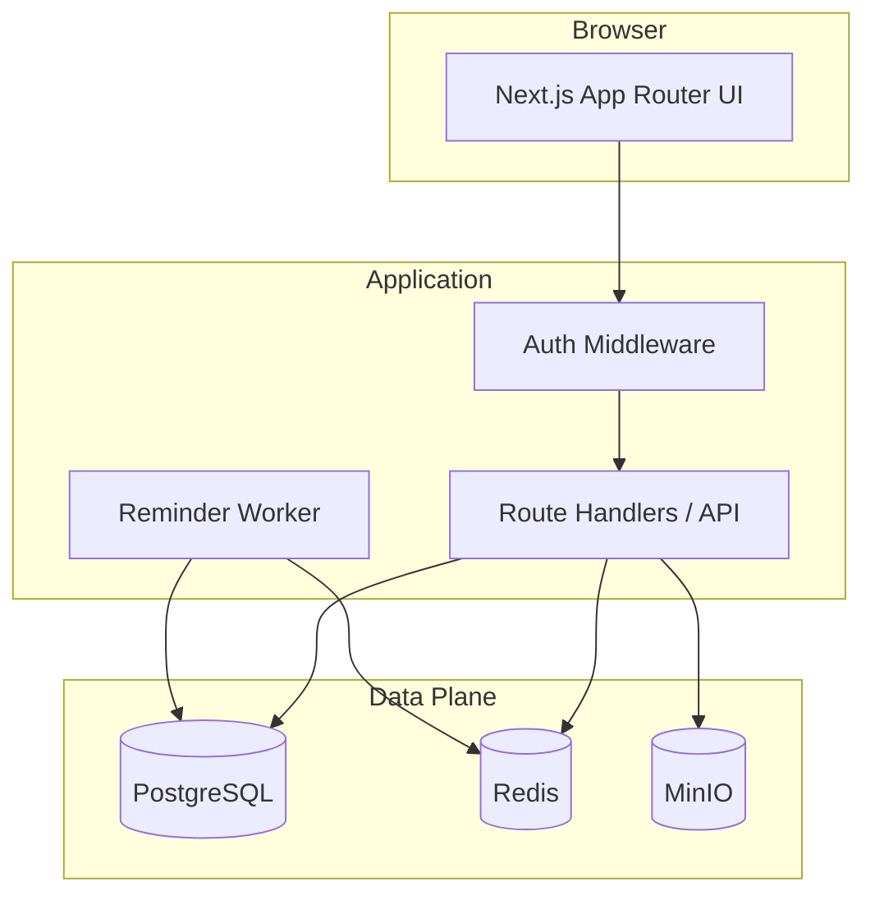
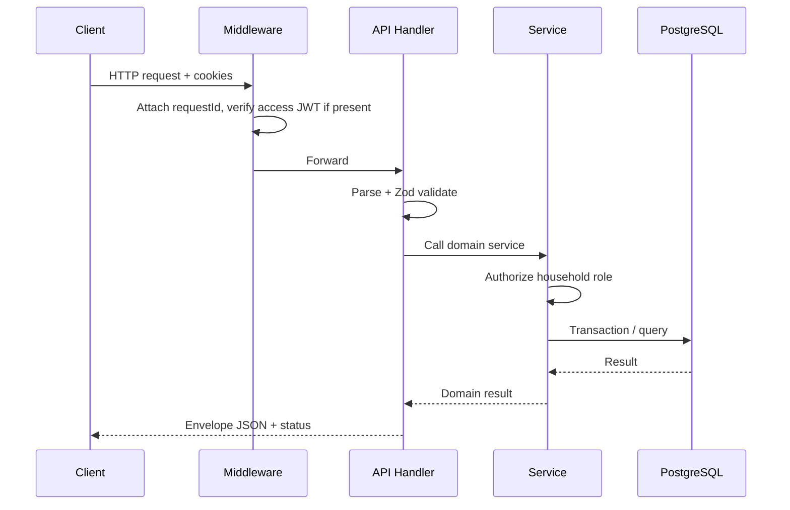
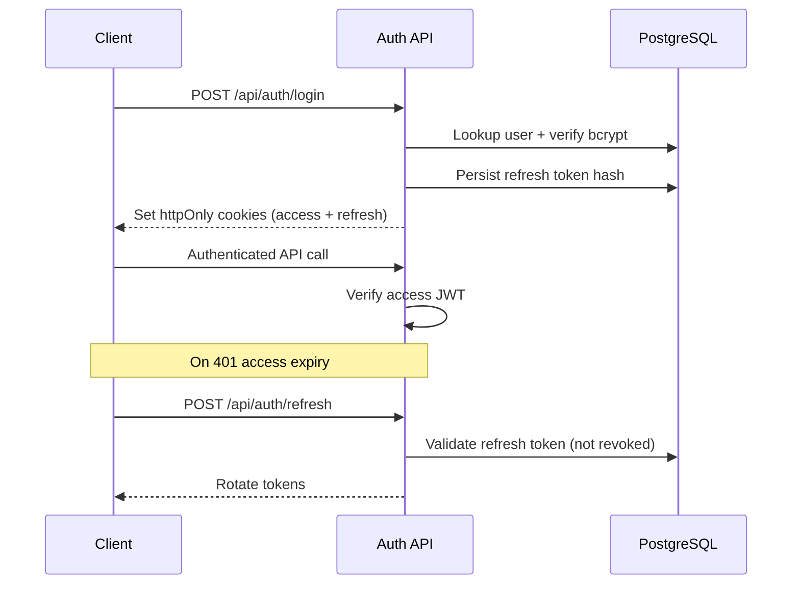
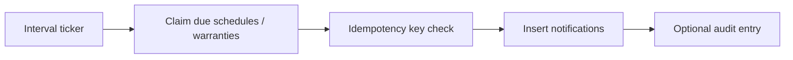

# Architecture — Home Maintenance Manager

## System Context



## Application Layers

```text
src/
  app/                 # Pages + Route Handlers
  components/          # Shared UI primitives
  features/            # Feature-scoped UI
  lib/
    auth/              # JWT, passwords, sessions
    db/                # Prisma client
    errors/            # AppError hierarchy
    http/              # Response helpers, request IDs
    authz/             # RBAC helpers
    storage/           # MinIO client
    cache/             # Redis client
    jobs/              # Reminder logic shared with worker
    validation/        # Zod schemas
    logger.ts
  services/            # Domain services (business rules)
  types/
  workers/             # Background process entry
```

## Request Flow



## Authentication Flow



## Reminder Worker Flow



## Caching Strategy

| What | Why | TTL | Invalidation | Redis down |
| --- | --- | --- | --- | --- |
| Dashboard summary per user/household | Reduce aggregate load | 30s | On asset/schedule/warranty mutation | Skip cache; query PG |
| Auth rate-limit counters | Brute-force protection | Window length | Natural expiry | In-memory fallback (single instance) |

PostgreSQL remains source of truth for all transactional data.

## Queue / Jobs Strategy

No Kafka for this project. A single worker process polls every 60s:

1. Find schedules with `next_due_at <= now + reminder_lead` and no reminder for today
2. Find warranties ending within lead window
3. Insert notifications with unique constraint on idempotency key

Retries: failed batch logged; next tick retries. No external queue broker required.

## Deployment Topology

| Component | Local | Production-ish |
| --- | --- | --- |
| Next.js UI + API | `npm run dev` | Vercel (serverless) |
| Worker | `npm run worker` | Free VM / Railway free / always-on Docker host |
| PostgreSQL | Docker | Managed free tier or self-host |
| Redis | Docker | Self-host or omit (fallback) |
| MinIO | Docker | Self-host S3-compatible |

Vercel cannot run the long-lived worker or MinIO; document separation clearly.

## Engineering Decisions

1. **Monolith Next.js API** — portfolio clarity and fewer moving parts than Nest/Express split.
2. **Household-scoped RBAC** — realistic multi-user without full SaaS tenancy complexity.
3. **Worker as separate process** — teaches job isolation without Kafka overhead.
4. **MinIO over filesystem** — demonstrates object storage patterns portably.
