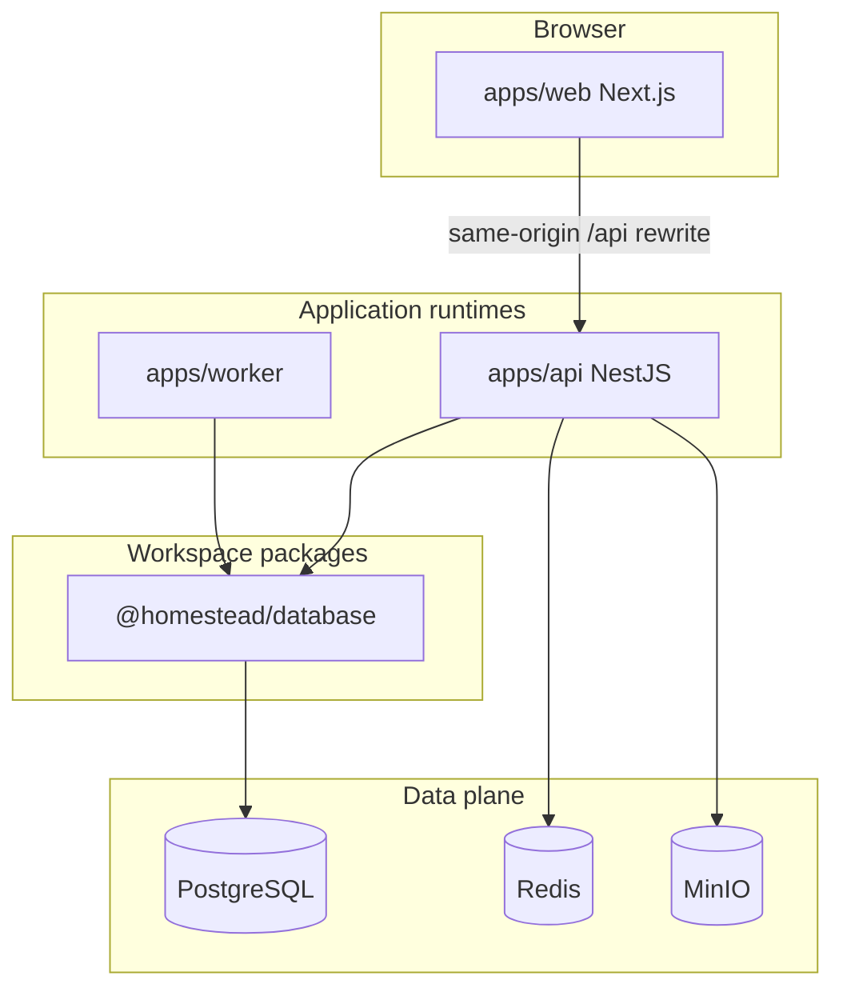

# Architecture — Homestead Keep (post-migration)

## System context

## Package boundaries

| Path | Responsibility |
| --- | --- |
| `apps/web` | UI only; proxies `/api/*` to Nest |
| `apps/api` | REST, authz, validation, domain services, MinIO/Redis |
| `apps/worker` | Reminder dispatch (no HTTP server) |
| `packages/database` | Prisma schema, migrations, seed, exported client |
| `infrastructure` | Docker Compose for Postgres/Redis/MinIO |

## Request flow

1. Browser calls `https://localhost:3005/api/...` (cookies included).
2. Next.js rewrite forwards to Nest `API_URL` (`:4005`).
3. Nest validates JWT cookie, enforces household RBAC, uses `@homestead/database`.
4. Envelope JSON responses match the pre-migration API contracts.

## Why NestJS + separate web

- Clear backend boundary for portfolio demonstration
- Worker isolated from HTTP lifecycle
- Database package shared without duplicating Prisma schema
- Vercel hosts UI only; API/worker run as Node processes
