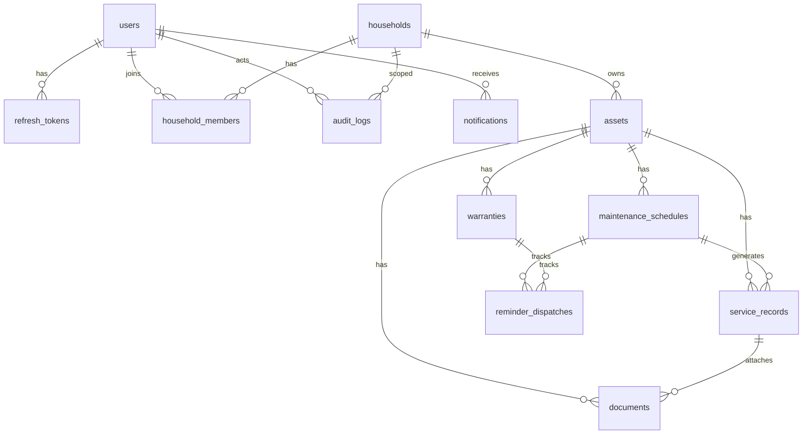

# Database Design — Home Maintenance Manager

## ER Diagram



## Tables

### users
| Column | Type | Notes |
| --- | --- | --- |
| id | UUID PK | |
| email | CITEXT UNIQUE NOT NULL | |
| password_hash | TEXT NOT NULL | bcrypt |
| full_name | TEXT NOT NULL | |
| created_at / updated_at | TIMESTAMPTZ | |

### refresh_tokens
| Column | Type | Notes |
| --- | --- | --- |
| id | UUID PK | |
| user_id | UUID FK | ON DELETE CASCADE |
| token_hash | TEXT UNIQUE NOT NULL | SHA-256 of token |
| expires_at | TIMESTAMPTZ NOT NULL | |
| revoked_at | TIMESTAMPTZ NULL | |
| created_at | TIMESTAMPTZ | |
| user_agent / ip | TEXT NULL | audit only |

### households
| Column | Type | Notes |
| --- | --- | --- |
| id | UUID PK | |
| name | TEXT NOT NULL | |
| address_line1 | TEXT NULL | |
| address_line2 | TEXT NULL | |
| city / region / postal_code / country | TEXT NULL | |
| notes | TEXT NULL | |
| created_by | UUID FK users | |
| created_at / updated_at | TIMESTAMPTZ | |

### household_members
| Column | Type | Notes |
| --- | --- | --- |
| id | UUID PK | |
| household_id | UUID FK | |
| user_id | UUID FK | |
| role | ENUM OWNER/MANAGER/MEMBER | |
| created_at | TIMESTAMPTZ | |
| UNIQUE(household_id, user_id) | | |

### assets
| Column | Type | Notes |
| --- | --- | --- |
| id | UUID PK | |
| household_id | UUID FK | |
| name | TEXT NOT NULL | |
| category | ENUM APPLIANCE/VEHICLE/HVAC/ELECTRONICS/OUTDOOR/OTHER | |
| status | ENUM ACTIVE/RETIRED/DISPOSED | default ACTIVE |
| manufacturer / model / serial_number | TEXT NULL | |
| purchase_date | DATE NULL | |
| purchase_price | NUMERIC(12,2) NULL | |
| location_notes | TEXT NULL | |
| notes | TEXT NULL | |
| deleted_at | TIMESTAMPTZ NULL | soft delete |
| created_by | UUID FK | |
| created_at / updated_at | TIMESTAMPTZ | |

### maintenance_schedules
| Column | Type | Notes |
| --- | --- | --- |
| id | UUID PK | |
| asset_id | UUID FK | |
| title | TEXT NOT NULL | |
| description | TEXT NULL | |
| frequency | ENUM | see PRD |
| interval_days | INT NULL | for CUSTOM_DAYS |
| next_due_at | TIMESTAMPTZ NOT NULL | |
| last_completed_at | TIMESTAMPTZ NULL | |
| is_active | BOOLEAN DEFAULT true | |
| reminder_days_before | INT DEFAULT 7 | CHECK >= 0 |
| created_at / updated_at | TIMESTAMPTZ | |

### service_records
| Column | Type | Notes |
| --- | --- | --- |
| id | UUID PK | |
| asset_id | UUID FK | |
| schedule_id | UUID FK NULL | |
| title | TEXT NOT NULL | |
| performed_at | TIMESTAMPTZ NOT NULL | |
| cost | NUMERIC(12,2) NULL | |
| vendor | TEXT NULL | |
| notes | TEXT NULL | |
| created_by | UUID FK | |
| created_at / updated_at | TIMESTAMPTZ | |

### warranties
| Column | Type | Notes |
| --- | --- | --- |
| id | UUID PK | |
| asset_id | UUID FK | |
| provider | TEXT NOT NULL | |
| coverage_notes | TEXT NULL | |
| starts_on | DATE NOT NULL | |
| ends_on | DATE NOT NULL | CHECK ends_on >= starts_on |
| created_at / updated_at | TIMESTAMPTZ | |

### documents
| Column | Type | Notes |
| --- | --- | --- |
| id | UUID PK | |
| household_id | UUID FK | |
| asset_id | UUID FK NULL | |
| service_record_id | UUID FK NULL | |
| file_name | TEXT NOT NULL | |
| content_type | TEXT NOT NULL | |
| size_bytes | INT NOT NULL | CHECK > 0 |
| storage_key | TEXT NOT NULL UNIQUE | MinIO object key |
| uploaded_by | UUID FK | |
| deleted_at | TIMESTAMPTZ NULL | |
| created_at | TIMESTAMPTZ | |

### notifications
| Column | Type | Notes |
| --- | --- | --- |
| id | UUID PK | |
| user_id | UUID FK | |
| household_id | UUID FK | |
| type | ENUM MAINTENANCE_DUE/WARRANTY_EXPIRING/SYSTEM | |
| title | TEXT NOT NULL | |
| body | TEXT NOT NULL | |
| link_path | TEXT NULL | |
| read_at | TIMESTAMPTZ NULL | |
| created_at | TIMESTAMPTZ | |

### reminder_dispatches
Idempotency for worker.

| Column | Type | Notes |
| --- | --- | --- |
| id | UUID PK | |
| idempotency_key | TEXT UNIQUE NOT NULL | e.g. `schedule:{id}:{YYYY-MM-DD}` |
| schedule_id | UUID NULL | |
| warranty_id | UUID NULL | |
| dispatched_at | TIMESTAMPTZ | |

### audit_logs
| Column | Type | Notes |
| --- | --- | --- |
| id | UUID PK | |
| household_id | UUID NULL | |
| actor_user_id | UUID NULL | |
| action | TEXT NOT NULL | e.g. ASSET_CREATED |
| entity_type | TEXT NOT NULL | |
| entity_id | UUID NULL | |
| metadata | JSONB | |
| created_at | TIMESTAMPTZ | |

## Indexes (justified)

| Index | Query | Why | Cost |
| --- | --- | --- | --- |
| `users_email_key` | login | Unique lookup | Low write |
| `household_members(user_id)` | list my households | Membership lookup | Low |
| `household_members(household_id, role)` | find owners | Role checks | Low |
| `assets(household_id, deleted_at, status)` | filtered asset lists | Partial active lists | Medium |
| `assets(household_id, name)` | search | Text filter support | Medium |
| `maintenance_schedules(next_due_at) WHERE is_active` | worker + dashboard overdue | Partial index reduces size | Low write amplification |
| `maintenance_schedules(asset_id)` | asset detail | FK join | Low |
| `warranties(ends_on)` | expiring soon | Range scan | Low |
| `service_records(asset_id, performed_at DESC)` | history timeline | Ordered list | Medium |
| `notifications(user_id, read_at, created_at DESC)` | inbox | Unread + recent | Medium |
| `reminder_dispatches(idempotency_key)` | worker dedupe | UNIQUE | Low |
| `audit_logs(household_id, created_at DESC)` | audit UI | Timeline | Medium |
| `documents(asset_id) WHERE deleted_at IS NULL` | asset files | Partial | Low |

## Important Queries

```sql
-- Overdue schedules for a household
SELECT ms.*
FROM maintenance_schedules ms
JOIN assets a ON a.id = ms.asset_id
WHERE a.household_id = $1
  AND a.deleted_at IS NULL
  AND ms.is_active
  AND ms.next_due_at < NOW();

-- Dashboard counts (example)
SELECT
  COUNT(*) FILTER (WHERE ms.next_due_at < NOW()) AS overdue,
  COUNT(*) FILTER (WHERE ms.next_due_at BETWEEN NOW() AND NOW() + INTERVAL '7 days') AS due_7d
FROM maintenance_schedules ms
JOIN assets a ON a.id = ms.asset_id
WHERE a.household_id = $1 AND a.deleted_at IS NULL AND ms.is_active;
```

## Transaction Strategy

1. **Schedule completion**: BEGIN → insert service_record → update schedule.next_due_at / last_completed_at → audit → COMMIT
2. **Household create**: BEGIN → insert household → insert OWNER membership → audit → COMMIT
3. **Document upload**: upload to MinIO first; on DB failure, best-effort delete object (compensating)
4. **Token refresh**: revoke old refresh row, insert new hash in one transaction

## Soft Delete

- Assets and documents: soft delete to preserve history links
- Users/households: hard constraints; household delete cascades carefully (OWNER only)

## Data Retention

- Audit logs retained indefinitely for portfolio demo
- Soft-deleted documents retained; hard purge script optional later
